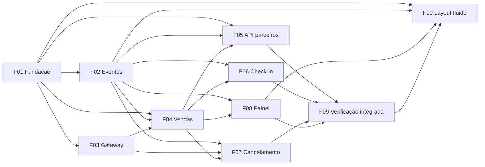

# PRD — Catraca MVP

> Fonte: o brief da fundadora (regras **R01–R13**, contrato fixo da API de parceiros e gateway simulado).
> Este PRD divide o produto em features rastreáveis, declara o que cada uma **provê** e **consome**, traz o
> grafo de dependências, as waves e os critérios de aceite — por feature e **cross-feature**.
> Cada feature tem pasta própria em `docs/features/<ID>-<nome>/` com `spec.md`, `plan.md`, `contract.md` e `reports/`.

## 1. Objetivo

Vender ingressos (um por compra) para eventos pequenos, pela vitrine (participante logado) e pela API de
parceiros, com check-in na porta, cancelamento de evento com estorno e um painel por evento — sem nunca vender
além da lotação, nem sob compras simultâneas.

## 2. Atores

| Ator | Como entra | O que faz |
|---|---|---|
| Visitante | sem login | vê a vitrine e a página pública de eventos à venda |
| Participante | cria conta (nome, e-mail, senha) | entra, sai, compra ingresso, vê "Meus ingressos" |
| Organizador | conta vinda da seed (sem cadastro pelo produto) | cria, edita, publica, cancela os próprios eventos; faz check-in; vê o painel |
| Parceiro | `X-Api-Key` | lista eventos à venda, compra e consulta ingressos pela API |

## 3. Modelo de domínio (resumo)

- **Evento**: `draft` (rascunho) → `published` (publicado) → `cancelled` (cancelado, irreversível).
  À venda = `published` (e, por consequência, não cancelado).
- **Ingresso**: `pending` → `confirmed` | `declined`; com o evento cancelado, `pending` → `cancelled` e
  `confirmed` → `refunded`. `checkedIn` é um atributo à parte (não é status).
  Rótulos na interface: pendente, confirmado, recusado, cancelado, estornado.
- **Vagas ocupadas** = ingressos `pending` + `confirmed`. **Vagas disponíveis** = lotação − ocupadas; em evento
  cancelado, 0.
- **Cobrança** (gateway): pedida no mesmo instante da compra, respondida de forma assíncrona.
- Fuso: todas as datas são interpretadas e exibidas em America/Sao_Paulo (UTC−03:00, sem horário de verão).

## 4. Features

| ID | Feature | Wave | Consome |
|---|---|---|---|
| F01 | Fundação, contas e harness | 1 | — |
| F02 | Eventos do organizador e vitrine | 2 | F01 |
| F03 | Gateway de pagamento simulado | 2 | F01 |
| F04 | Vendas: compra, vagas e "Meus ingressos" | 3 | F01, F02, F03 |
| F05 | API de parceiros | 4 | F01, F02, F04 |
| F06 | Check-in | 4 | F02, F04 |
| F07 | Cancelamento de evento | 4 | F02, F03, F04 |
| F08 | Painel do evento | 4 | F02, F04 |
| F09 | Verificação integrada (Fluxo do avaliador automatizado) | 5 | F05, F06, F07, F08 |
| F10 | Layout fluido em azul e roxo | 6 | F01, F02, F08, F09 |

### F01 — Fundação, contas e harness

Esqueleto do produto (Node.js + Express + PostgreSQL em Docker), harness (subir, derrubar, gates), seed, sessões
e contas.

**Provê**
- `P-F01-1` Banco: `src/core/db.js` (`pool`, `query`, `withTransaction(fn)`), migrações SQL em
  `src/db/migrations/NNN_<feature>.sql` executadas em ordem, uma vez cada, na subida.
- `P-F01-2` Carregador de módulos: cada `src/modules/<nome>/index.js` exporta `{ name, order, register(app), start? }`
  e é montado automaticamente (sem editar arquivo central).
- `P-F01-3` HTML e layout: `html` (template com escape automático), `raw`, `page({ title, user, body })`.
- `P-F01-4` Sessão e papéis: `req.user` (`{ id, name, email, role }`), `requireRole('organizer' | 'participant')`.
- `P-F01-5` Contas: `/signup` (sempre cria participante), `/login`, `/logout`.
- `P-F01-6` Seed idempotente: organizador A, organizador B e participante.
- `P-F01-7` Harness: `scripts/up.sh`, `scripts/down.sh`, `scripts/gates.sh`, `docker-compose.yml`, `AGENTS.md`,
  helpers de teste em `test/helpers/` (servidor de teste, reset do banco, cliente HTTP com cookies).
- `P-F01-8` Utilitários: `src/core/config.js`, `time.js` (fuso −03:00), `money.js` (centavos ↔ "R$ 1.234,56"),
  `ids.js` (ids com prefixo e códigos de ingresso).

**Consome**: —

**Critérios de aceite**
- `F01-CA01` Em um clone limpo, `./scripts/up.sh` deixa o produto acessível em `$WEB` com migrações e seed
  aplicadas, sem nenhum outro passo.
- `F01-CA02` `./scripts/down.sh` encerra tudo que a subida iniciou: `$WEB` não responde e nenhum container do
  projeto continua rodando.
- `F01-CA03` Depois de derrubar, subir de novo funciona sem erro (a seed roda de novo) e as credenciais da seed
  continuam válidas.
- `F01-CA04` `./scripts/gates.sh` roda lint e testes automatizados e termina com código 0.
- `F01-CA05` O visitante cria conta de participante com nome, e-mail e senha, entra e sai; e-mail repetido ou dados
  inválidos são rejeitados com mensagem.
- `F01-CA06` A seed cria dois organizadores e um participante; o produto não tem cadastro de organizador
  (o `/signup` sempre cria participante).
- `F01-CA07` (R13) A área do organizador (`/organizer` e sub-rotas) exige papel organizador: visitante é levado ao
  login e participante recebe 403, sem nenhum dado de evento.
- `F01-CA08` O `AGENTS.md` da raiz traz os comandos de subir, derrubar e gates, as regras do projeto e o mapa dos
  artefatos; o `CLAUDE.md` aponta para ele.

### F02 — Eventos do organizador e vitrine

Ciclo de vida do evento (rascunho → publicado), área do organizador, página de gestão com endereço próprio e a
vitrine pública.

**Provê**
- `P-F02-1` Tabela `events` (migração `002_events.sql`).
- `P-F02-2` Serviço `src/modules/events/service.js`: `createEvent`, `updateEvent`, `publishEvent`, `getEvent`,
  `listOrganizerEvents`, `listOnSaleEvents` (publicados e não cancelados), `validateEventInput`.
- `P-F02-3` Página de gestão `GET /organizer/events/:id` (R04) e middleware `loadOwnedEvent` (organizador dono ou 404).
- `P-F02-4` Pontos de extensão: `addManagementSection({ key, order, render })` (seções da página de gestão),
  `renderManagementPage(req, res, event, { results })`, `setCapacityGuard(fn)` (R03),
  `addStorefrontExtra(render)` (vitrine e página pública do evento).
- `P-F02-5` Vitrine `GET /` e página pública `GET /events/:id` (só eventos à venda).

**Consome**: F01 (`P-F01-1..4`, `P-F01-8`).

**Critérios de aceite**
- `F02-CA01` (R01, R02) O organizador cria evento com nome, data e hora de início, local, lotação (inteiro ≥ 1) e
  preço (> 0); o evento nasce rascunho e aparece na sua lista.
- `F02-CA02` (R01) Data de início no passado é rejeitada ao criar e ao editar; lotação < 1, preço ≤ 0 ou campo
  faltando também.
- `F02-CA03` (R02) Rascunho não aparece na vitrine nem em `listOnSaleEvents()` e sua página pública responde 404;
  depois de publicado, aparece.
- `F02-CA04` (R04) Cada evento tem página de gestão em `/organizer/events/{id}`, com edição, publicação e as seções
  registradas por outras features.
- `F02-CA05` (R03) Aumentar a lotação é aceito; reduzir passa pelo capacity guard e é rejeitado quando ele acusa
  lotação menor que as vagas ocupadas.
- `F02-CA06` (R13) O organizador B não vê eventos de A na lista; GET ou POST no endereço de gestão de A (e sub-rotas)
  responde 404 sem nenhum dado de A.
- `F02-CA07` (R11) Evento cancelado não pode ser editado nem publicado.

### F03 — Gateway de pagamento simulado

Gateway externo simulado, assíncrono e persistente: a cobrança é registrada na compra e respondida depois, por um
worker, conforme o final do cartão.

**Provê**
- `P-F03-1` Tabela `gateway_charges` (migração `003_gateway.sql`).
- `P-F03-2` `src/modules/gateway/index.js`: `isValidCardNumber(card)`, `simulateResponse(card, rng)`,
  `requestCharge(client, { ticketId, cardNumber, amountCents })` (na transação do chamador, retorna na hora),
  `onGatewayResponse(handler)` e `processDueCharges()`.
- `P-F03-3` Worker iniciado pelo módulo (`start`), com `GATEWAY_TIME_SCALE` (padrão 1) e `GATEWAY_POLL_MS`.

**Consome**: F01 (`P-F01-1`, `P-F01-2`, `P-F01-8`).

**Critérios de aceite**
- `F03-CA01` A resposta simulada segue a tabela do brief: final 0001 aprovado em 2–5 s; 0002 recusado em 2–5 s;
  0003 aprovado em 30–40 s; 0004 recusado em 30–40 s; qualquer outro final recusado em 2–5 s.
- `F03-CA02` Número de cartão válido tem exatamente 16 dígitos; o resto é inválido.
- `F03-CA03` (R06) `requestCharge` registra a cobrança e retorna sem esperar a resposta; o handler só recebe a
  resposta depois do instante sorteado.
- `F03-CA04` Cada resposta é entregue exatamente uma vez, mesmo com dois workers concorrentes; se o handler falhar,
  a resposta é reentregue na varredura seguinte.
- `F03-CA05` O modo padrão é o simulado e não exige chave ou segredo de pagamento; `GATEWAY_TIME_SCALE` só acelera
  testes.

### F04 — Vendas: compra, vagas e "Meus ingressos"

Serviço único de compra (vitrine e API), contagem de vagas, garantia de lotação sob concorrência, tratamento da
resposta do gateway e "Meus ingressos".

**Provê**
- `P-F04-1` Tabela `tickets` (migração `004_sales.sql`) com status, código único, preço pago, canal, comprador e
  `checked_in_at`.
- `P-F04-2` Serviço `src/modules/sales/service.js`: `purchaseTicket({ eventId, cardNumber, buyerEmail, userId, channel })`
  → `{ ok: true, ticket }` ou `{ ok: false, error: 'invalid_card' | 'event_not_available' | 'sold_out' }`;
  `getSeatAvailability(eventId)`, `getAvailabilityMap(eventIds)`, `getTicket(id)`, `findTicketByCode(code)`,
  `listUserTickets(userId)`, `TICKET_STATUS_LABELS`.
- `P-F04-3` Handler do gateway: aprovado → `confirmed`, recusado → `declined`, **só se o ingresso ainda estiver pendente**.
- `P-F04-4` Capacity guard registrado em F02 (R03) e extras da vitrine (vagas, formulário, "Ingressos esgotados").
- `P-F04-5` Rotas `POST /events/:id/purchase` (participante) e `GET /my-tickets` ("Meus ingressos").

**Consome**: F01 (`P-F01-1`, `P-F01-3`, `P-F01-4`, `P-F01-8`), F02 (`P-F02-2`, `P-F02-4`, `P-F02-5`),
F03 (`P-F03-2`).

**Critérios de aceite**
- `F04-CA01` (R06, R08, R09) O participante compra na página do evento com o cartão final 0001: o ingresso nasce
  pendente (a resposta não espera o gateway) e fica confirmado em até 5 s; "Meus ingressos" mostra evento,
  status (rótulo) e código.
- `F04-CA02` (R05, R06, R08) Compra pendente ocupa vaga; quando o gateway recusa, o ingresso fica recusado e a vaga
  é liberada.
- `F04-CA03` (R07) Sem vaga, a vitrine exibe `Ingressos esgotados` no lugar do formulário, e uma tentativa de compra
  é respondida com `Ingressos esgotados` sem criar ingresso.
- `F04-CA04` (R07) 30 compras simultâneas num evento de lotação 5 resultam em exatamente 5 aceitas e 25 `sold_out`;
  os testes repetem a rajada em pelo menos 10 eventos novos.
- `F04-CA05` (R03) Cada ingresso grava o preço vigente no momento da compra.
- `F04-CA06` (R09) Cada ingresso tem um código único de 8 caracteres.
- `F04-CA07` (R06) Cartão sem 16 dígitos é rejeitado antes de criar o ingresso.
- `F04-CA08` Visitante que tenta comprar é levado ao login; organizador não compra.

### F05 — API de parceiros

As três rotas do contrato fixo, autenticadas por `X-Api-Key`.

**Provê**: `GET /api/partner/events`, `POST /api/partner/events/{eventId}/purchases`,
`GET /api/partner/tickets/{ticketId}` (`src/modules/partner-api/`).

**Consome**: F01 (`P-F01-8`: `PARTNER_API_KEY`), F02 (`listOnSaleEvents`, `getEvent`), F04 (`purchaseTicket`,
`getAvailabilityMap`, `getTicket`).

**Critérios de aceite**
- `F05-CA01` (R02, R05) `GET /api/partner/events` → 200 com lista de `{ id, name, startsAt, priceCents, availableSeats }`,
  só de eventos publicados e não cancelados; `startsAt` em ISO 8601 com offset.
- `F05-CA02` (R06) Compra válida → 202 `{ ticketId, code, status: "pending" }`.
- `F05-CA03` (R07) Erros da compra na ordem: corpo inválido (campo faltando, JSON malformado, e-mail mal formado ou
  cartão sem 16 dígitos) → 422 `invalid_request`; evento inexistente, rascunho ou cancelado → 404
  `event_not_available`; sem vaga → 409 `sold_out`.
- `F05-CA04` `GET /api/partner/tickets/{id}` → 200 `{ ticketId, code, eventId, status, checkedIn }` para ingresso de
  qualquer canal; inexistente → 404 `ticket_not_found`.
- `F05-CA05` Sem `X-Api-Key` ou com chave inválida, as três rotas respondem 401 `{"error":"unauthorized"}`, antes de
  qualquer outra validação.

### F06 — Check-in

Campo de check-in na página de gestão, com as mensagens de R10 na ordem.

**Provê**: seção de check-in na página de gestão e `POST /organizer/events/:id/checkin` (`src/modules/checkin/`),
`checkIn(eventId, code)`.

**Consome**: F02 (`loadOwnedEvent`, `addManagementSection`, `renderManagementPage`, `getEvent`),
F04 (`findTicketByCode`, tabela `tickets`).

**Critérios de aceite**
- `F06-CA01` (R10) Código inexistente ou de outro evento → `Ingresso inválido para este evento`.
- `F06-CA02` (R10) Evento cancelado → `Evento cancelado`.
- `F06-CA03` (R10) Ingresso pendente, recusado, cancelado ou estornado → `Ingresso não confirmado`.
- `F06-CA04` (R10) Confirmado sem check-in → `Entrada liberada` (e passa a `checkedIn`); de novo →
  `Ingresso já utilizado`.
- `F06-CA05` (R10) A primeira situação verdadeira da lista vence (ex.: código de outro evento num evento cancelado →
  inválido; ingresso já usado num evento cancelado → `Evento cancelado`).
- `F06-CA06` (R10) Dois check-ins simultâneos do mesmo código resultam em exatamente um `Entrada liberada`.
- `F06-CA07` (R13) Só o organizador dono faz check-in no evento.

### F07 — Cancelamento de evento

Cancelamento irreversível com estorno dos confirmados e cancelamento dos pendentes.

**Provê**: seção "Cancelar evento" na página de gestão, `POST /organizer/events/:id/cancel`,
`cancelEvent(organizerId, eventId)` (`src/modules/cancellation/`).

**Consome**: F02 (`loadOwnedEvent`, `addManagementSection`, `renderManagementPage`, status do evento),
F03 (entrega tardia de respostas), F04 (tabela `tickets`, handler condicional).

**Critérios de aceite**
- `F07-CA01` (R11) O organizador cancela um evento publicado pela página de gestão; evento em rascunho ou já cancelado
  não é cancelado.
- `F07-CA02` (R11) Em até 10 s (na prática, na mesma transação), confirmados viram estornados e pendentes viram
  cancelados.
- `F07-CA03` (R05, R11) O evento cancelado sai da vitrine e da API, não vende mais e tem 0 vagas disponíveis.
- `F07-CA04` (R11) O evento cancelado não pode ser editado nem republicado; a página de gestão não oferece edição.
- `F07-CA05` (R11) Resposta do gateway que chega depois do cancelamento não muda o status de nenhum ingresso.
- `F07-CA06` (R13) Só o organizador dono cancela o evento.

### F08 — Painel do evento

**Provê**: seção "Painel" na página de gestão e `getDashboard(eventId)` (`src/modules/dashboard/`).

**Consome**: F02 (`addManagementSection`, evento), F04 (tabela `tickets`, `getSeatAvailability`).

**Critérios de aceite**
- `F08-CA01` (R12) A página de gestão mostra Confirmados, Pendentes, Check-ins, Vagas disponíveis, Receita e
  Estornados.
- `F08-CA02` (R12) Confirmados inclui os que já passaram pelo check-in; Check-ins conta só confirmados com check-in;
  estornados contam só em Estornados.
- `F08-CA03` (R03, R12) Receita = soma do preço gravado em cada ingresso confirmado (preço vigente na compra),
  exibida como `R$ 350,00`.
- `F08-CA04` (R05, R12) Vagas disponíveis = lotação − (pendentes + confirmados); 0 em evento cancelado.
- `F08-CA05` (R12) O painel conta vendas da vitrine e da API.
- `F08-CA06` (R13) Um organizador não vê o painel do evento de outro.

### F09 — Verificação integrada (Fluxo do avaliador automatizado)

Script que roda o Fluxo do avaliador (passos 2–16) contra o produto no ar, com os tempos reais do gateway, e o
script de rajada do passo 15. É onde as features da wave 4 se encontram.

**Provê**: `scripts/fluxo-avaliador.mjs`, `scripts/rajada.sh`.

**Consome**: F05, F06, F07, F08 (e, por meio delas, todo o produto).

**Critérios de aceite**
- `F09-CA01` `node scripts/fluxo-avaliador.mjs` executa os passos 2–16 do Fluxo do avaliador contra `$WEB` e `$API`,
  com o gateway no modo padrão, e todos passam.
- `F09-CA02` `scripts/rajada.sh` (passo 15), repetido em pelo menos 5 eventos novos, resulta sempre em 5 × `202` e
  25 × `409`.
- `F09-CA03` A partir de um clone limpo: subir, rodar o fluxo, rodar os gates, derrubar (nenhuma porta e nenhum
  container) e subir de novo — tudo sem erro (passos 1 e 17).

### F10 — Layout fluido em azul e roxo

Melhoria de apresentação pedida depois da entrega do MVP: um layout fluido, com azul e roxo como base, para todas
as páginas. Não muda comportamento: textos visíveis, rotas e marcadores `data-*` continuam os mesmos. O código entrou
pelo PR #10; spec, plano, contrato e avaliação foram registrados em seguida (ver `docs/features/F10-layout-fluido/`).

**Provê**
- `P-F10-1` Folha de estilo `src/core/style.js` (tokens azul/roxo, tipografia e espaçamentos fluidos com `clamp()`,
  grades com `auto-fit`, modo escuro por `prefers-color-scheme`), servida em `GET /assets/catraca.css?v=<hash>`.
- `P-F10-2` `page()` de F01 passa a referenciar a folha de estilo (sem CSS embutido), com `<nav>` no cabeçalho e
  rodapé; contêiner `.cards` na vitrine (F02) e `.metric` por número do painel (F08).

**Consome**: F01 (`page()`, rotas do app), F02 (vitrine e página de gestão), F08 (marcação do painel), F09 (fluxo
automatizado como prova de que nada do comportamento mudou).

**Critérios de aceite**
- `F10-CA01` Toda página referencia `/assets/catraca.css` e não embute CSS; a folha usa a paleta azul/roxo e o
  cabeçalho tem gradiente azul → roxo.
- `F10-CA02` O layout é fluido: com 375 px de largura, vitrine, página do evento, "Meus ingressos" e página de gestão
  não têm rolagem horizontal da página (tabelas rolam por dentro); em telas largas a vitrine mostra os eventos em
  grade com mais de uma coluna.
- `F10-CA03` Com `prefers-color-scheme: dark`, as páginas usam fundo escuro e texto claro, mantendo azul e roxo.
- `F10-CA04` Nenhum texto visível nem marcador `data-*` mudou: os gates e o Fluxo do avaliador continuam passando.

## 5. Grafo de dependências

Seta `A --> B` = B consome o que A provê. Cada aresta tem pelo menos um critério cross-feature (seção 7).

| Aresta (consumidor ← provedor) | O que flui | Critérios cross |
|---|---|---|
| F02 ← F01 | sessão, `requireRole`, layout, banco | X01 |
| F03 ← F01 | banco, migrações, ciclo de vida de módulos (worker) | X02 |
| F04 ← F01 | sessão de participante, conta criada no `/signup` | X03 |
| F04 ← F02 | evento publicado, capacity guard, extras da vitrine | X04, X05, X06 |
| F04 ← F03 | `requestCharge`, `onGatewayResponse` | X07 |
| F05 ← F01 | `PARTNER_API_KEY` da configuração do harness | X08 |
| F05 ← F02 | `listOnSaleEvents`, `getEvent` | X09 |
| F05 ← F04 | `purchaseTicket`, `getAvailabilityMap`, `getTicket` | X10, X11 |
| F06 ← F02 | página de gestão, `loadOwnedEvent`, status do evento | X12 |
| F06 ← F04 | ingressos e `findTicketByCode` | X13 |
| F07 ← F02 | página de gestão, status, bloqueio de edição | X14 |
| F07 ← F03 | entrega tardia de respostas | X16 |
| F07 ← F04 | ingressos, handler condicional | X15 |
| F08 ← F02 | página de gestão, dono do evento | X17 |
| F08 ← F04 | ingressos, preço pago, `getSeatAvailability` | X18 |
| F09 ← F05 | API de parceiros integrada | X19 |
| F09 ← F06 | check-in integrado | X20 |
| F09 ← F07 | cancelamento integrado | X21 |
| F09 ← F08 | painel integrado | X22 |
| F10 ← F01 | `page()` (layout), rotas do app | X23 |
| F10 ← F02 | vitrine (cards) e página de gestão (seções) | X24 |
| F10 ← F08 | marcação do painel (`data-metric`) | X25 |
| F10 ← F09 | Fluxo do avaliador automatizado | X26 |

## 6. Waves

| Wave | Features | Execução |
|---|---|---|
| 1 | F01 | sequencial (base de tudo) |
| 2 | F02, F03 | **paralela**: duas branches, dois agentes ao mesmo tempo, dois PRs |
| 3 | F04 | sequencial (precisa de F02 e F03) |
| 4 | F05, F06, F07, F08 | **paralela**: quatro branches, quatro agentes ao mesmo tempo, quatro PRs |
| 5 | F09 | sequencial, sobre a `main` integrada |
| 6 | F10 | sequencial, melhoria de apresentação depois da entrega (PR #10) |

Regras para paralelizar sem pisar no outro: cada feature tem módulo próprio (`src/modules/<nome>/`), migração com
número reservado (`002` F02, `003` F03, `004` F04), testes em `test/<ID>/` e se pluga por pontos de extensão
(F01: carregador de módulos; F02: seções da página de gestão, extras da vitrine e capacity guard; F03: handler de
resposta). Conflitos remanescentes (README, `state.json`) são resolvidos no merge.

## 7. Critérios cross-feature

| ID | Aresta | Critério | Regras |
|---|---|---|---|
| X01 | F02 ← F01 | O organizador A da seed entra e `/organizer` lista só os eventos dele; um participante logado recebe 403 em `/organizer/events/new`. | R13 |
| X02 | F03 ← F01 | O app iniciado pelo harness (`./scripts/up.sh` / helper de teste) aplica a migração do gateway e inicia o worker: uma cobrança registrada recebe resposta sem nenhum passo manual e sem chave de pagamento. | R06, R08 |
| X03 | F04 ← F01 | Um participante criado em `/signup` compra e vê o ingresso em "Meus ingressos"; um visitante sem sessão que tenta comprar é levado ao login. | R06, R09, R13 |
| X04 | F04 ← F02 | Evento publicado na gestão aparece na vitrine com formulário de compra; rascunho não aceita compra. | R02 |
| X05 | F04 ← F02 | Com 2 vagas ocupadas por ingressos vendidos, reduzir a lotação para 1 na página de gestão é rejeitado e aumentar para 3 é aceito. | R03, R05 |
| X06 | F04 ← F02 | Preço alterado na gestão vale só para compras feitas depois; ingressos anteriores mantêm o preço pago. | R03 |
| X07 | F04 ← F03 | Compra com final 0001 fica confirmada depois da resposta do gateway; com final 0002 fica recusada e a vaga volta. | R08 |
| X08 | F05 ← F01 | A chave de parceiro configurada pelo harness (`PARTNER_API_KEY`, documentada no README) é aceita pela API logo após a subida; outra chave é recusada. | — (contrato da API) |
| X09 | F05 ← F02 | A listagem da API mostra só eventos publicados e não cancelados, com `priceCents` igual ao preço atual do evento. | R02 |
| X10 | F05 ← F04 | Compras pela API passam pelo serviço de vendas: ocupam vaga, refletem em `availableSeats` e, com 30 compras simultâneas em lotação 5, resultam em 5 × 202 e 25 × 409. | R05, R07 |
| X11 | F05 ← F04 | Ingresso comprado na vitrine pode ser consultado em `GET /api/partner/tickets/{id}`; a confirmação do gateway aparece como `confirmed`. | R06, R08 |
| X12 | F06 ← F02 | O check-in aparece na página de gestão e só o dono do evento consegue usá-lo (organizador B → 404); evento cancelado → `Evento cancelado`. | R04, R10, R13 |
| X13 | F06 ← F04 | Ingressos criados pelo serviço de vendas (vitrine e API), em cada status, produzem a mensagem certa de R10; ingresso de outro evento → `Ingresso inválido para este evento`. | R10 |
| X14 | F07 ← F02 | Depois de cancelado, o evento sai da vitrine e de `listOnSaleEvents`, e a página de gestão recusa edição e publicação. | R02, R11 |
| X15 | F07 ← F04 | O cancelamento converte os ingressos do serviço de vendas (confirmados → estornados, pendentes → cancelados) em até 10 s; uma nova compra é recusada e as vagas disponíveis ficam 0. | R05, R11 |
| X16 | F07 ← F03 | Resposta do gateway que chega depois do cancelamento não altera o ingresso cancelado. | R11 |
| X17 | F08 ← F02 | O painel aparece na página de gestão do evento e o organizador B não vê os números do evento de A. | R12, R13 |
| X18 | F08 ← F04 | O painel conta ingressos da vitrine e da API com as definições de R12; a receita usa o preço gravado em cada compra; Vagas disponíveis = `getSeatAvailability`. | R03, R05, R12 |
| X19 | F09 ← F05 | Na `main` integrada, os passos de API do fluxo (2, 4, 6–8, 15, 16) passam. | R02, R05–R08 |
| X20 | F09 ← F06 | Na `main` integrada, os passos de check-in (10, 11 com C3 de outro organizador, 14 com `Evento cancelado`) passam. | R10, R13 |
| X21 | F09 ← F07 | Na `main` integrada, os passos de cancelamento (12–14), inclusive a resposta tardia do gateway, passam. | R11 |
| X22 | F09 ← F08 | Na `main` integrada, o painel nos passos 9, 10, 14 e 15 bate com o estado dos ingressos (estorno fora da receita). | R12 |
| X23 | F10 ← F01 | As páginas montadas por `page()` carregam `/assets/catraca.css` (200, `text/css`) e não embutem CSS; uma página negada (404 de evento de outro organizador) não expõe nenhum seletor ou marcador de dados. | R13 |
| X24 | F10 ← F02 | A vitrine mostra os cards de evento numa grade fluida (`.cards`), sem mudar `<article class="card" data-event-id=…>`; a página de gestão mantém as seções `data-section`. | R02, R04 |
| X25 | F10 ← F08 | O painel mostra um card por número (`.metric`) com os mesmos `data-metric` e valores de antes. | R12 |
| X26 | F10 ← F09 | Com o layout novo, `node scripts/fluxo-avaliador.mjs` passa inteiro (passos 2–16). | R01–R13 |

## 8. Rastreabilidade das regras

| Regra | Critérios |
|---|---|
| R01 | F02-CA01, F02-CA02 |
| R02 | F02-CA01, F02-CA03, F05-CA01, X04, X09, X14, X19 |
| R03 | F02-CA05, F04-CA05, F08-CA03, X05, X06, X18 |
| R04 | F02-CA04, X12, X24 |
| R05 | F04-CA02, F05-CA01, F07-CA03, F08-CA04, X05, X10, X15, X18 |
| R06 | F03-CA03, F04-CA01, F04-CA02, F04-CA07, F05-CA02, X02, X03, X11 |
| R07 | F04-CA03, F04-CA04, F05-CA03, X10, X19 |
| R08 | F04-CA01, F04-CA02, X02, X07, X11 |
| R09 | F04-CA01, F04-CA06, X03 |
| R10 | F06-CA01 … F06-CA06, X12, X13, X20 |
| R11 | F02-CA07, F07-CA01 … F07-CA05, X14, X15, X16, X21 |
| R12 | F08-CA01 … F08-CA05, X17, X18, X22, X25 |
| R13 | F01-CA07, F02-CA06, F06-CA07, F07-CA06, F08-CA06, X01, X03, X12, X17, X23 |

## 9. Fora de escopo

- Deploy e qualquer ambiente além do local (Docker Compose na máquina).
- Gateway de pagamento real, e-mail e notificações (o gateway é sempre o simulado; outro modo falha na subida).
- App mobile. Qualidade visual não é critério do brief: o layout fluido de F10 é melhoria de apresentação, sem
  mudar comportamento.
- Cadastro de organizador pelo produto (só seed), recuperação de senha, edição de perfil.
- Mais de um ingresso por compra, mapa de assentos, cancelamento ou transferência de ingresso pelo participante.
- Atualização em tempo real (recarregar a página basta).
- Fusos diferentes de America/Sao_Paulo; despublicar evento (rascunho ← publicado); excluir evento.
- Gestão de chaves de parceiro (uma chave por configuração, documentada no README); rate limiting.

## 10. Premissas e decisões transversais

- **Stack**: Node.js 24 + Express 5 + PostgreSQL 17, tudo em Docker Compose; HTML renderizado no servidor (sem
  build de front-end). Detalhes e justificativa no README e em `docs/features/F01-fundacao/spec.md`.
- **R07 sob concorrência**: toda compra roda numa transação que trava a linha do evento (`SELECT … FOR UPDATE`),
  conta as vagas ocupadas e só então insere o ingresso. Edição de lotação e cancelamento travam a mesma linha.
  Provado por teste automatizado (rajadas repetidas) e pelo script de rajada.
- **Gateway assíncrono**: a cobrança é gravada na mesma transação da compra com o instante sorteado da resposta;
  um worker entrega as respostas vencidas; o handler só altera ingresso que ainda está `pending` (R11).
- **Avaliação isolada**: cada feature é avaliada por um subagente novo, de contexto vazio, que recebe só o caminho do
  contrato e o commit; o relatório é commitado uma única vez e nunca editado.
